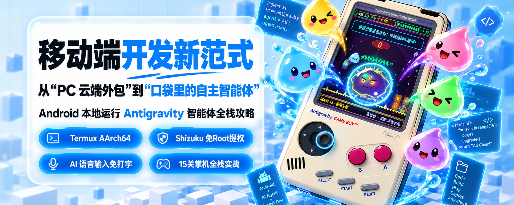
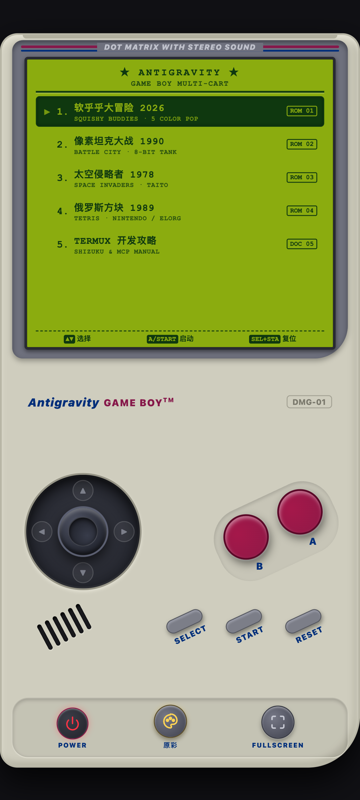
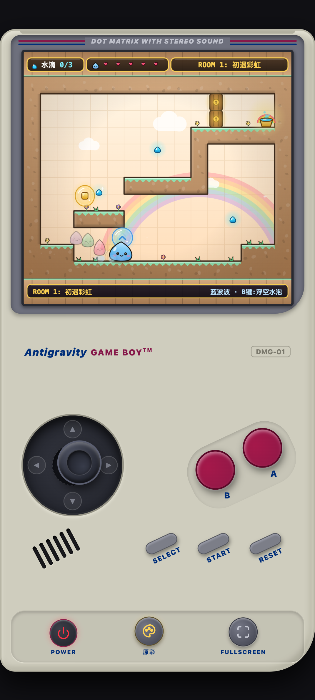
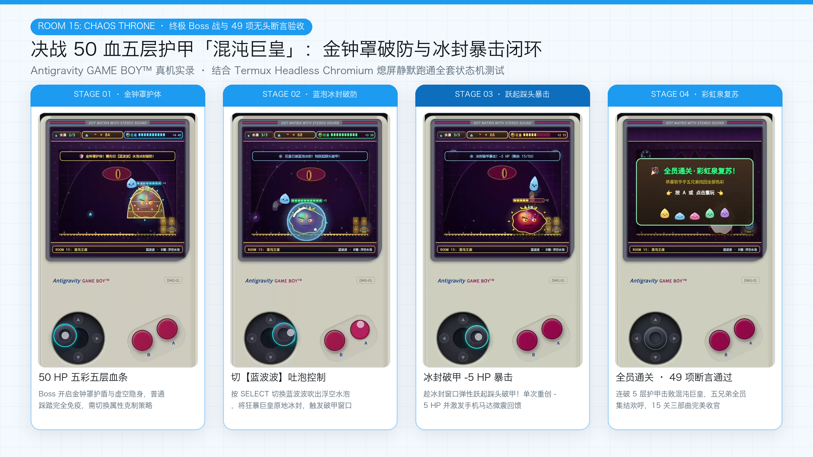
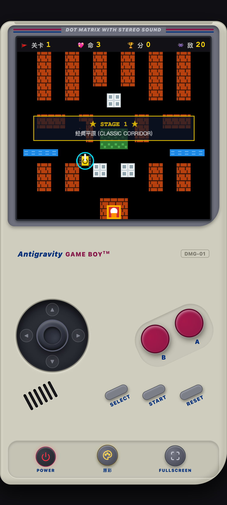
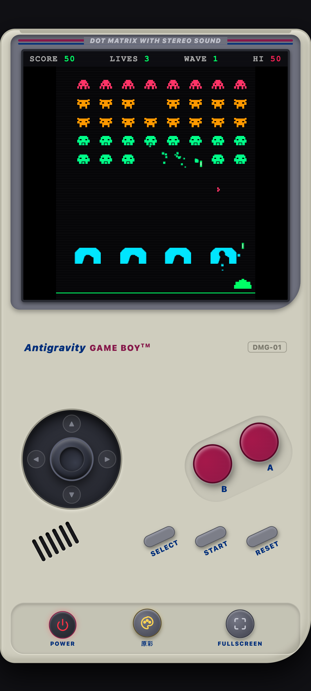
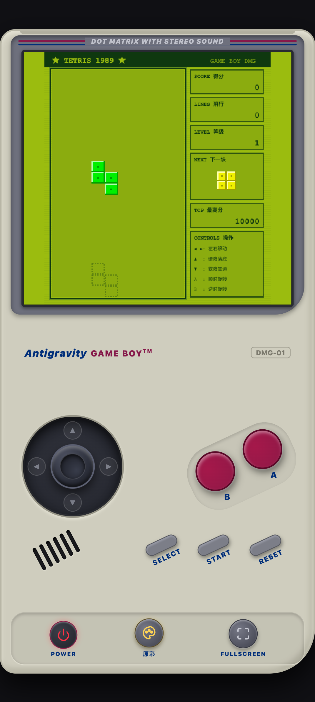

# 🕹️ Antigravity Retro Game Boy Console (掌机模拟器)
### 📱 纯 Android 手机原生环境研发 · 移动优先 · 复古掌机模拟器与原创游戏合集

[](https://github.com/termux/termux-app)
[]()
[]()
[]()
[](LICENSE)

> 本项目为完全在 **Android 手机（Termux 原生沙盒 + Shizuku 提权 + Headless Chromium）** 内借助 **Antigravity AI 智能体** 从 0 到 1 驱动研发完成的 **Game Boy 复古掌机模拟器** 与多款纯自研游戏实战工程。



---

## 🌟 核心特性与掌机硬件级架构

### 1. 🎮 经典 Game Boy (DMG-01) 掌机模拟器外壳 (`index.html`)
- **真实掌机人体工学设计**：
  - 经典灰白工程塑料质感外壳，右下角标志性圆弧切角与左置 6 槽扬声器格栅。
  - 屏幕边框 `DOT MATRIX WITH STEREO SOUND` 经典刻字与红蓝双色饰线。
- **防连键虚拟摇杆与物理震动按键**：
  - **四向正交死区虚拟摇杆 (Tactile Virtual Joystick)**：带青色霓虹呼吸光环，彻底解决手机玻璃屏幕多指盲操斜向误触问题。
  - **倾斜 A / B 键**：经典 -25° 倾角排布，深酒红烤漆质感，调用 `navigator.vibrate` 提供分层触觉反馈。
  - **SELECT / START / RESET 橡胶条三键**：支持游戏内切人、暂停与一键热插拔返回主菜单。
- **多重显示调色板 (Palette Switcher)**：
  - 🎨 **原彩 (True Color)**：无扫描线的高清果冻/街机原彩画面。
  - 🌈 **街机扫描线 (CRT Color)**：带复古 CRT 扫描线质感的彩色模式。
  - 🟢 **经典点阵 (DMG)**：1989 复古橄榄绿液晶屏点阵滤镜。
  - ⚪ **Pocket 黑白**：高对比度纯净黑白电子屏风格。

---

## 🕹️ 内置 5 合 1 游戏与文档卡带列表

### 💧 卡带 1：软乎乎大冒险 2026 (`games/squishy-buddies/` · 主打旗舰卡带)
- **五彩果冻水滴战队（`SELECT` 键秒切 + 贪吃蛇弹性跟随队列）**：
  1. **黄圆圆（大黄）**：固化垫脚泡（凌空搭桥、封堵机关）
  2. **蓝波波（蓝波）**：浮空水泡（包裹怪物浮空、**冰封 Boss 破除金钟罩**）
  3. **粉噗噗（粉嘟）**：绝壁粘泡（垂直墙面生成攀爬粘梯）
  4. **绿萌萌（绿萌）**：翡翠弹力泡（高倍率弹簧蹦床跳跃）
  5. **紫灵灵（紫灵）**：连锁爆破泡（延时炸裂粉碎暗道岩石）
- **15 关三部曲 + 50 HP 终极 Boss 战**：
  - 涵盖「彩虹泉启程」、「风霜雪域」、「幽暗熔岩」三大主题共 15 个单屏解谜房间。
  - 第 15 关 **「混沌王座」** 迎战 50 血 5 层彩甲 **「混沌巨皇」**，实现「金钟罩护体 → 蓝波吐泡冰封 → 跃起踩头 `-5 HP` 暴击」的硬核动作闭环。


### 🎮 卡带 2：像素坦克大战 1990 (`games/tank-battle/`)
- 经典砖墙、钢墙、隐匿森林、河流与老鹰基地防卫战。
- 独创 **向量解耦碰撞解死锁算法（Vector Decoupling Algorithm）**，彻底消除多坦克贴脸挤压死锁。

### 👾 卡带 3：太空侵略者 1978 (`games/space-invaders/`)
- 经典三类外星人矩阵编队、动态加速 4 步低音进行曲、红色神秘 UFO 与 **像素级弹坑侵蚀掩体（Crater Erosion）**。

### 🧱 卡带 4：俄罗斯方块 1989 (`games/tetris/`)
- 原汁原味 DMG 点阵风俄罗斯方块，支持 Ghost 落点预览、SRS 墙踢旋转与消行连击合成音效。

### 📖 卡带 5：TERMUX 开发攻略 (`tutorial.html`)
- 内置掌机电子书模式，随时用摇杆与按键阅读移动端 Agent 自动化研发全攻略。

---

## 📸 运行效果截图（最新掌机真机与无头渲染实拍）

### 1. 掌机主菜单、软乎乎大冒险 2026 实机闯关与 50 血终极 Boss 战
| 5 合 1 掌机主菜单 (`ROM 01-05`) | 《软乎乎大冒险 2026》果冻物理与吐泡闯关 | 《软乎乎大冒险 2026》Room 15 混沌巨皇 Boss 战 |
| :---: | :---: | :---: |
|  |  |  |

### 2. 终极 Boss 战「金钟罩破防与冰封暴击」四阶段全流程实录


### 3. 经典街机卡带合集（坦克大战 1990 / 太空侵略者 1978 / 俄罗斯方块 1989）
| 《像素坦克大战 1990》激战实拍 | 《太空侵略者 1978》弹坑掩体与激光对轰 | 《俄罗斯方块 1989》点阵堆叠实拍 |
| :---: | :---: | :---: |
|  |  |  |

### 4. Android 本地 Antigravity + Shizuku + Headless Chromium 全闭环架构


---

## 📂 项目模块化目录树

```
tank-game/
├── index.html                   # 🕹️ Game Boy 掌机主入口模拟器 (5合1卡带热插拔)
├── css/
│   └── gameboy.css              # 掌机 DMG-01 仿真外壳、虚拟摇杆与调色板样式
├── js/
│   └── console.js               # 掌机系统 OS、换卡调度、按键桥接与开机音效
├── games/
│   ├── squishy-buddies/         # 💧 软乎乎大冒险 2026 (五彩水滴战队 · 15关 + Boss战)
│   ├── tank-battle/             # 🎮 像素坦克大战 1990 模块
│   ├── space-invaders/          # 👾 太空侵略者 1978 模块
│   └── tetris/                  # 🧱 俄罗斯方块 1989 模块
├── tests/                       # 🧪 49 项自动化断言测试与 Headless Chromium 挂机脚本
│   ├── run_tests.js             # 物理引擎、5角色状态机与 Boss 战全套单元测试
│   ├── test_squishy_levels.js   # 15 关关卡设计与通关路径审计
│   └── headless_runner.js       # Puppeteer + Termux Chromium 自动操控与截图流水线
├── ANDROID_AUTOMATION_TUTORIAL.md # 📚 万字移动端 Agent 本地化开发全攻略
├── tutorial.html                # 教程离线网页与掌机内置电子书预览版
├── images/                      # 最新真机实拍与架构图解资源
├── README.md                    # 项目说明文档
└── LICENSE                      # MIT 开源协议
```

---

## 🚀 本地运行与自动化测试

1. **启动本地 Web 静态服务**：
   ```bash
   python3 -m http.server 8080
   ```

2. **运行 49 项全自动单元测试与关卡审计**：
   ```bash
   node tests/run_tests.js
   ```

3. **在浏览器中打开体验**：
   - **Game Boy 掌机总控台**：[http://localhost:8080/index.html](http://localhost:8080/index.html)
   - **独立运行《软乎乎大冒险 2026》**：[http://localhost:8080/games/squishy-buddies/index.html](http://localhost:8080/games/squishy-buddies/index.html)
   - **阅读极客实战教程**：[http://localhost:8080/tutorial.html](http://localhost:8080/tutorial.html)

---

## 🔗 移动端开发核心软件下载与官方文档索引

1. **Termux 终端与系统桥接插件（请保持同源签名）**
   - **Termux GitHub Releases**：[https://github.com/termux/termux-app/releases](https://github.com/termux/termux-app/releases)
   - **Termux:API GitHub Releases**：[https://github.com/termux/termux-api/releases](https://github.com/termux/termux-api/releases)
   - **F-Droid 官方发布页**：[https://f-droid.org/packages/com.termux/](https://f-droid.org/packages/com.termux/)

2. **Shizuku 免 Root 无线调试提权（`uid=2000` ADB Shell）**
   - **Shizuku 官网与使用文档**：[https://shizuku.rikka.app/zh-hans/](https://shizuku.rikka.app/zh-hans/)
   - **Shizuku GitHub Releases**：[https://github.com/RikkaApps/Shizuku/releases](https://github.com/RikkaApps/Shizuku/releases)

3. **MT 管理器与官方 MCP 服务文档**
   - **MT 管理器官方下载**：[https://mt2.cn/download/](https://mt2.cn/download/) / [https://binmt.cc/download/](https://binmt.cc/download/)
   - **MT 管理器官方 MCP 服务文档**：[https://binmt.cc/doc/guide/mcp.html](https://binmt.cc/doc/guide/mcp.html)
   - **MT 管理器在线手册中心**：[https://binmt.cc/doc/guide/](https://binmt.cc/doc/guide/)
   - **MT 官方论坛交流区**：[https://bbs.binmt.cc/](https://bbs.binmt.cc/)

4. **在线体验与开源仓库**
   - **Game Boy 掌机在线体验 (GitHub Pages)**：[https://yuanyang749.github.io/tank-game/](https://yuanyang749.github.io/tank-game/)
   - **GitHub 源码仓库**：[https://github.com/yuanyang749/tank-game](https://github.com/yuanyang749/tank-game)

---

## 📄 开源许可证

本项目遵循 [MIT License](LICENSE) 开源协议。
